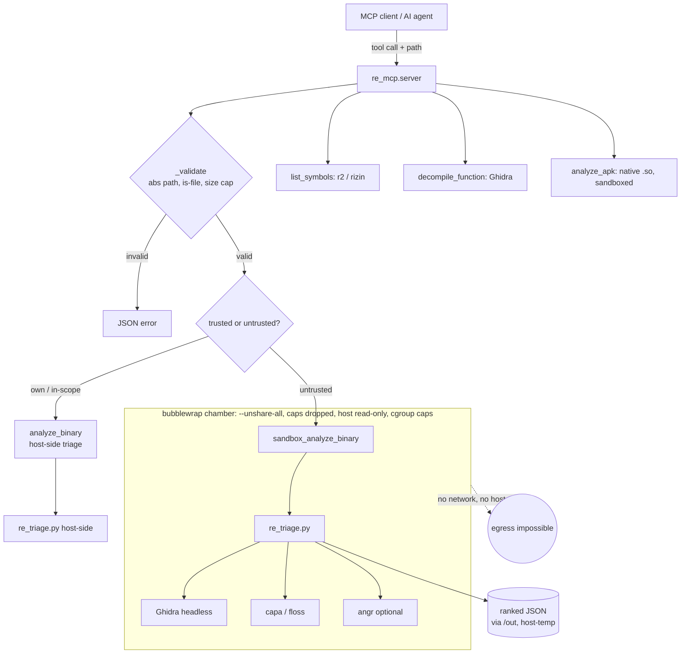

# airgap-re

**A security-first reverse-engineering MCP server.** It gives an AI agent (Claude Code,
Cursor, any MCP client) a small, read-only set of static reverse-engineering tools over a
proven, auditable stack — and runs every *untrusted* sample inside a no-network bubblewrap
chamber that never executes the target.

[](https://github.com/NEO849/airgap-re/actions/workflows/ci.yml)


> **Status — v0.1.0, early but gated.** The surface is small and the API may still move, but
> nothing merges unless the isolation proof runs green in CI. We would rather ship a narrow tool
> whose guarantees are real than a broad one whose guarantees are hopes.

> **Scope / lawful use.** For software you own, in-scope bug-bounty targets, CTFs, abandonware,
> and interoperability research permitted by law. Read-only by design: it never patches,
> rebuilds, or executes the target. See [`SECURITY.md`](SECURITY.md) and the [Threat Model](THREAT_MODEL.md).

---

## Contents

- [Why this exists](#why-this-exists-and-where-it-does-not-compete)
- [What it is, precisely](#what-it-is-precisely)
- [Architecture & trust boundary](#architecture--trust-boundary)
- [The security guarantees — proven in CI](#the-security-guarantees--proven-in-ci-not-asserted)
- [Honest comparison vs. REA](#honest-comparison-vs-rea-morlutorea)
- [Install](#install)
- [Usage](#usage-workflow)
- [Project layout](#project-layout)
- [License](#license)

---

## Why this exists (and where it does *not* compete)

A wave of "AI reverse-engineers anything over MCP" tooling is genuinely useful — broad,
convenient, well-packaged. The best-known of them, [`morluto/rea`](https://github.com/morluto/rea),
covers an impressively wide surface (native, mobile, web, firmware, network, WASM, managed code).
**On raw breadth, REA leads, and this project does not try to match it.**

This project makes a different, narrower bet: when you point an analysis tool at a *hostile*
binary, the thing that matters most is **isolation and auditability**, not feature count. That is
exactly the axis where broad orchestrators tend to be weakest — many run their dynamic/runtime
paths with your own user privileges and no container at all.

★ **The honest one-liner:** REA optimizes for *breadth*; `airgap-re` optimizes for
*safety and auditability on the native-static lane* — the lane where you actually touch
untrusted code.

---

## What it is, precisely

A stdio MCP server (Python, one pinned dependency) that orchestrates a **pre-existing** RE stack:

| Backend | Used for |
|---|---|
| Ghidra (headless) | per-function decompilation, function inventory |
| `re_triage.py` (capa · floss · sink-ranking · angr) | full static triage → ranked suspicious functions |
| r2 / rizin | fast symbol/import/string inventory |
| jadx / apktool (native-lib path) | Android APK native `.so` triage |
| **bubblewrap (bwrap)** | the isolation chamber for untrusted samples |

It contains **no RE logic of its own** — it is a thin, auditable bridge. That is a deliberate
feature: the whole server is small enough to read in one sitting (~1,200 lines of own code).

### MCP tools exposed

| Tool | What it does |
|---|---|
| `re_capabilities` | health check: which backends are present + versions |
| `analyze_binary` | full host-side static triage of a native binary (own/in-scope) |
| `sandbox_analyze_binary` | same triage, **isolated** (no network, cgroup caps) — for untrusted samples |
| `sandbox_selftest` | live proof of the isolation guarantees (no analysis target needed) |
| `decompile_function` | one function → C via Ghidra |
| `list_symbols` | fast r2/rizin inventory (functions / imports / strings) |
| `analyze_apk` | Android native-lib triage (sandboxed by default) |

---

## Architecture & trust boundary

The server holds no RE logic; it validates input, picks the trusted vs. sandboxed path, and shells
out to a pre-existing backend stack. **The sandbox boundary is the product** — everything below
`bubblewrap` is treated as hostile when the sample is third-party.



Full data flow, properties, and the trust boundary: [`docs/architektur.md`](docs/architektur.md).

---

## The security guarantees — *proven in CI, not asserted*

Every claim below has a test that fails the build if the guarantee breaks
([`tests/test_sandbox_isolation.py`](tests/test_sandbox_isolation.py)).
The tests drive the **shipped** script (`engine/sandbox_analyze.sh --selftest`), not a
hand-rolled command — so the guard covers the exact code the server runs. Removing
`--unshare-all` from the shipped script turns the egress test red (verified by sabotage).

- **No egress.** The chamber runs `bwrap --unshare-all`, which removes the network namespace.
  An outbound connection is not blocked by policy — it is *structurally impossible*.
  → `test_shipped_script_blocks_egress`
- **Host filesystem is read-only**, except one throwaway `/out` (a `mktemp` dir) that is removed
  on exit; writes to host paths fail. → `test_shipped_script_host_readonly`
- **Resource caps.** A cgroup `MemoryMax` + `MemorySwapMax=0` makes a memory-bomb OOM-killed
  instead of taking the host down. → `test_cgroup_memory_cap_enforced`
- **The target is never executed.** The pipeline is purely static; the sample is mounted
  read-only and analysed as data.

Run the proof yourself:

```bash
pip install -e ".[dev]"
pytest -v          # includes the isolation proof (needs bubblewrap)
```

### Non-goal (stated honestly)

No custom **seccomp-BPF** filter is applied. bwrap applies none by default, and a wrong filter
would silently break Ghidra/Python. Isolation here rests on **namespaces (`--unshare-all`) +
capability drop + read-only binds + cgroup limits** — not on a syscall filter we cannot verify.
A reviewed seccomp profile is possible future work, not a current claim.

---

## Honest comparison vs. REA (`morluto/rea`)

The *left* column is measured by [`benchmark/run_benchmark.py`](benchmark/run_benchmark.py) on this
repo (see [`benchmark/REPORT.md`](benchmark/REPORT.md)). The *right* column is from REA's public repo /
README and our 2026-10-12 tool review — **external, not measured here.**

| Dimension | airgap-re | REA (morluto/rea) |
|---|---|---|
| Tool breadth | native + APK-native (focused) | very broad — **REA leads** |
| Untrusted-sample isolation | bwrap no-net + cgroup, never executed | **no sandbox**; runtime paths run with your user rights |
| Runtime dependencies | **1 direct** (`mcp`) / 27 transitive | ~35 npm (per our review — different counting basis) |
| Setup footprint | local; does **not** write into your agent config | `npx … setup` writes into `~/.claude` |
| Auditability | ~1,200 lines of own code | large tree (~2,255 files, per our review) |
| License | MIT | MIT |

> If you need the widest possible toolbox on trusted inputs, REA is a strong choice. If you need
> to analyse **someone else's** binary without handing it your privileges, this is built for that.

---

## Install

```bash
git clone https://github.com/NEO849/airgap-re
cd airgap-re
python -m venv .venv && . .venv/bin/activate
pip install -e .

# System tools (analysis backends — bring your own, like any RE tool):
#   bubblewrap (required for the sandbox), radare2/rizin, Ghidra (headless),
#   optional: capa, floss, jadx, apktool, angr venv.
sudo apt-get install -y bubblewrap radare2
```

Register with your MCP client (stdio). Example `~/.claude.json` fragment:

```json
{
  "mcpServers": {
    "airgap-re": {
      "type": "stdio",
      "command": "/path/to/.venv/bin/python",
      "args": ["-m", "re_mcp.server"],
      "env": { "REMCP_GHIDRA_HEADLESS": "/opt/ghidra/support/analyzeHeadless" }
    }
  }
}
```

All paths auto-discover from `PATH` and common install locations; override any via `REMCP_*`
environment variables (see [`re_mcp/config.py`](re_mcp/config.py)). Confirm the wiring with the
`re_capabilities` tool — it reports which backends are present and their versions.

---

## Usage (workflow)

1. `re_capabilities` — see what's available.
2. `list_symbols` — fast overview, pick targets.
3. `analyze_binary` (own/in-scope) **or** `sandbox_analyze_binary` (untrusted) — ranked triage.
4. `decompile_function` — read the candidates.

**Untrusted / third-party samples always go through `sandbox_analyze_binary`.**

---

## Project layout

```
re_mcp/        server.py (MCP tools) · config.py (env/auto-discovery)
engine/        re_triage.py · sandbox_analyze.sh · apk_native_triage.sh · ghidra_scripts/
tests/         test_validate.py · test_sandbox_isolation.py (the proof)
benchmark/     run_benchmark.py → REPORT.md
docs/          architektur.md (data-flow diagram)
```

See [`docs/architektur.md`](docs/architektur.md) for the data-flow and trust boundaries,
[`THREAT_MODEL.md`](THREAT_MODEL.md) for what the sandbox does and does not defend against,
and [`CONTRIBUTING.md`](CONTRIBUTING.md) to hack on it.

## License

MIT — see [`LICENSE`](LICENSE).
