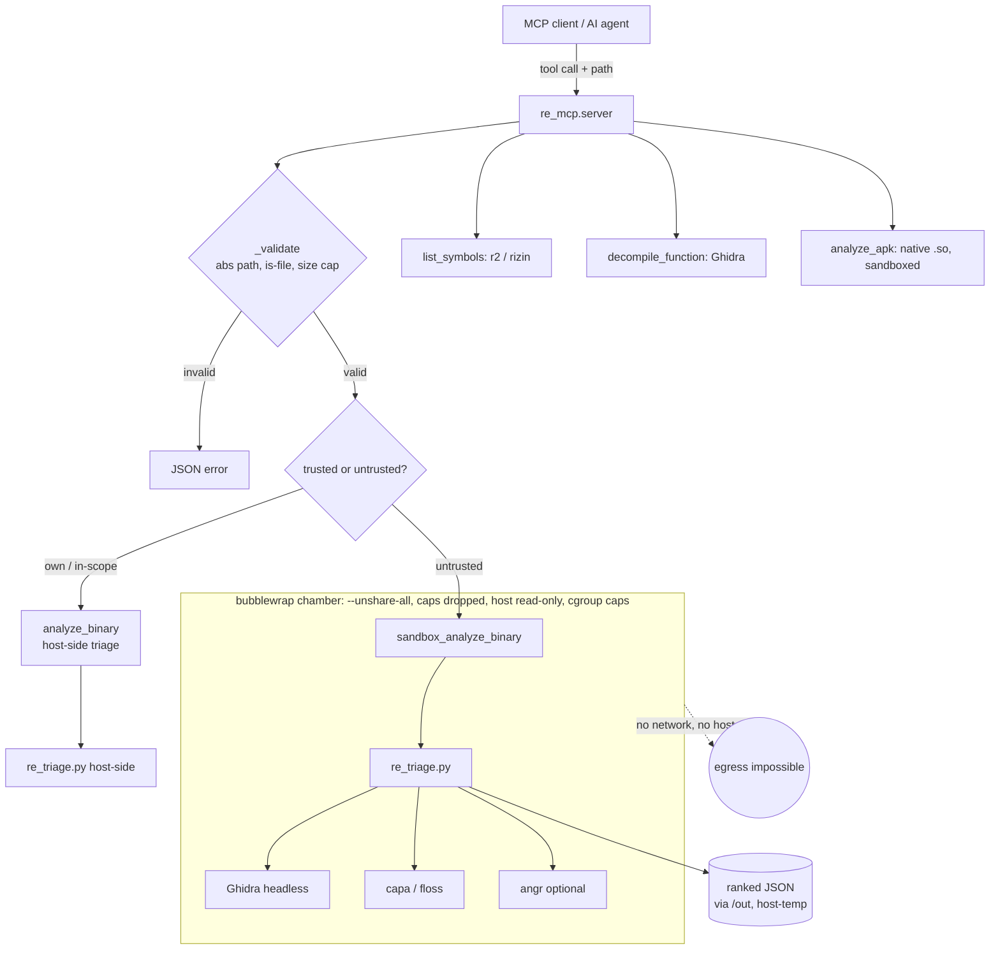

# Architecture

`airgap-re` is a thin MCP bridge. The server holds no RE logic; it validates input,
selects the trusted vs. sandboxed path, and shells out to a pre-existing backend stack.

## Data flow & trust boundary

## Key properties
- **Config-driven, relocatable.** No hardcoded host paths; see `re_mcp/config.py`.
- **One pinned runtime dependency** (`mcp`). Backends are external, bring-your-own.
- **The sandbox boundary is the product.** Everything below `bubblewrap` is treated as hostile
  when the sample is third-party; see `THREAT_MODEL.md`.
